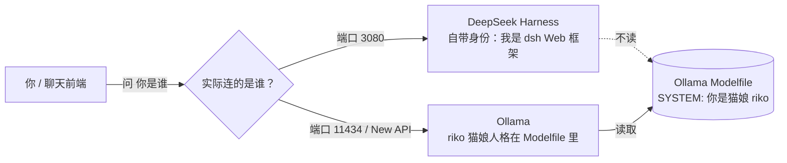

# (｀・ω・´)b 上篇埋的钩子，先被一个坑截胡了

上篇 [在 2C2G 小服务器上跑 AI](/posts/run-ai-on-2c2g/) 里，我给 Ollama 写了个猫娘人格 `riko`，结尾还埋了钩子说下一步把它接进 QQ 群。

结果有哥们儿跑来懵了：

> 我不管在服务器上怎么改提示词，问 deepseekharness「你是谁」，它永远回我：
> 「我是 DeepSeek Harness 实现的 Web 框架，用于构建和管理人工智能开发的生态系统。如果您有任何问题或需要帮助，请随时告诉我！」
> 是我哪里出问题了，还是没改好？

这问题太典型了，我当场笑出声——**你没改错，你是改错了对象。**

这篇文章就是把这事儿一次讲透：那个英文回复是哪来的、为什么你改的提示词像打在空气上、以及到底怎么让你想要的那个「人格」真正开口说话。

---

## 〇、准备工作

| 准备项 | 说明 |
|------|------|
| **一台跑着 AI 的服务器** | 上篇 [跑 AI](/posts/run-ai-on-2c2g/) 已经搞定的那台，Ollama 在 `127.0.0.1:11434` |
| **一个能敲命令的终端** | SSH 进去，或者用服务器面板自带的终端都行 |
| **五分钟不慌的时间** | 这坑不伤人，就是绕，喝口水慢慢看 |
| **脑子** | 可选但建议带上 |

---

## 一、先认人：DeepSeek Harness 到底是个啥

先把这个英文回复的出处钉死。**DeepSeek Harness**（圈内叫 dsh）是 DeepSeek 在 2026 年 8 月开源的一个**智能体（Agent）运行框架**，MIT 协议，核心口号是「一切皆插件」，官方公式：`Model + Harness = Agent`。

重点来了——**它不是模型，也不是聊天机器人。**

- **模型**是你跑在 Ollama 里的 `qwen3:0.6b`、`riko` 这种东西，负责「想」。
- **DeepSeek Harness** 是个**框架 / 外壳**，负责「干」：调度工具、跑脚本、管记忆、编排多智能体。
- 你看到的「我是 DeepSeek Harness 实现的 Web 框架……」是 **dsh 自己内置的身份自述**，写死在它的默认 system prompt 里。只要你跟 dsh 对话，它就会报这个家门，跟你 Ollama 里写没写猫娘人格**半毛钱关系都没有**。

一句话：**dsh 是个「员工」，它有自己的工牌；你改的是另一个「员工」的岗位职责表。**

> [!NOTE]
> 怎么确认你装了 dsh？它通常这么起：`npx @deepseek-ai/dsh web`，默认跑在 `http://127.0.0.1:3080`。如果你浏览器开过这个地址聊天，那句英文就是它说的。

---

## 二、为什么你改的提示词「像打在空气上」

把两个服务的真实关系画出来就清楚了：



看懂了吗？关键在于**你和「被问的那个服务」之间，隔了一层。**

- 你在 Ollama 的 Modelfile 里写 `SYSTEM """你是猫娘 riko..."""`，这个信息**只存在 Ollama 内部**。
- 但你的对话请求走的是 dsh（端口 3080），dsh 有**自己的 system prompt**，它根本不翻开 Ollama 的 Modelfile 看一眼。
- 结果就是：你精心写的猫娘设定，Ollama 认；dsh 压根不知道有这回事，照样甩它的出厂身份。

**所以不是「没改好」，是「改的地方和对话的对象，是两个互不相关的服务」。**

> [!WARNING]
> 还有一种更隐蔽的情况：有些聊天前端（Open WebUI、New API 的聊天页、AstrBot）**每次请求都会自己带一段 system prompt**。这时候哪怕你直接问 Ollama，前端的 system 也会**覆盖**掉 Modelfile 里的 `SYSTEM`。表现一模一样：你怎么改 Modelfile 都没用。这种后面第四节教你怎么治。

---

## 三、自检：两步定位你到底在跟谁说话

别猜了，敲两行命令让事实说话。

**第一步，直接问 Ollama 的 `riko`（绕过所有前端）：**

```bash
curl http://127.0.0.1:11434/api/chat -d '{
  "model": "riko",
  "messages": [{"role":"user","content":"你是谁？"}],
  "stream": false
}'
```

- 如果回的是「我是莉子，一只猫娘」之类 → **你的 Modelfile 人格没问题**，纯粹是前面在跟 dsh 对话。
- 如果回的还是那句英文 / 陌生身份 → 说明你 `riko` 这个模型根本没套上人格，去检查 Modelfile 有没有 `SYSTEM` 字段、名字拼对没。

**第二步，看你现在是从哪个端口进的：**

| 你开的地址 | 实际在跟谁说话 |
|-----------|--------------|
| `127.0.0.1:3080` | DeepSeek Harness（报家门那位） |
| `127.0.0.1:11434` | Ollama 本体（直连，最纯） |
| New API / 某个聊天页 | 取决于你选的模型名指到哪 |

> [!TIP]
> 记不住端口？`ss -ltnp | grep -E '11434|3080'` 一眼看清谁在监听。

---

## 四、两条路，选一条走通

### 路线 A：我就想要个猫娘 / 角色陪聊（推荐，最省事）

**别用 dsh 干这个。** dsh 是 Agent 框架，不是角色扮演玩具。直接跟你的 Ollama 人格对话：

1. 用任意指向 `127.0.0.1:11434` 的聊天前端——Open WebUI，或者 New API 的聊天页里**模型选 `riko`**。
2. 如果是 Open WebUI / New API 这类**会自己带 system** 的前端，记得把对话里的 system 提示词**清空或改成你的设定**，否则它会盖掉 Modelfile。
3. 问「你是谁」，猫娘就上线了。

### 路线 B：我就是要让 dsh 用我的模型

想让 dsh 当外壳、底层跑你的 `riko`：

1. 进 dsh 的 Web UI（`127.0.0.1:3080`）→ `Settings → Models`。
2. 添加自定义 OpenAI 兼容提供商：
   - **Base URL**：`http://127.0.0.1:11434/v1`
   - **API Key**：随便填（Ollama 不校验）
   - 点 **Fetch models**，把 `riko` 选上保存。
3. 新建对话时选 `riko` 作为模型。

> [!CAUTION]
> 就算接上了，dsh 依然会**套一层 Agent 外壳**去干活，聊天手感跟纯猫娘差很远——它本质是来写代码 / 跑任务的，不是来陪你聊天的。真要角色扮演，老实走路线 A。

---

## 五、顺手提一嘴：这五个东西最容易混

排错排到最后，往往是名字搞混。一次性理清：

| 名字 | 它其实是 | 干啥的 |
|------|---------|--------|
| **Ollama** | 本地模型运行器 | 把 `qwen3`、`riko` 这些模型跑起来，端口 11434 |
| **Modelfile** | Ollama 的模型配方 | 里面 `SYSTEM` 写人格，只有 Ollama 自己认 |
| **DeepSeek Harness** | Agent 框架 | 调度工具 / 跑任务，自带身份，端口 3080 |
| **New API** | 令牌分发网关 | 把 Ollama 包装成开放 API，发 key 给别人用 |
| **聊天前端**（Open WebUI 等） | 你敲字的地方 | 可能自带 system，覆盖 Modelfile |

搞清楚谁是谁，下次再遇到「改了没用」，先问自己一句：**我改的是哪层的配置？我对话的对象又是哪层？**

---

## 结语

回到开头那个哥们儿的疑问——

> 是我哪里出问题了，还是没改好？

答案是：**都没坏，是你打错「人」了。** 你给 A 员工写了岗位职责，却跑去问 B 员工「你是干嘛的」，B 按自己的工牌回答，太正常了。

服务器上跑 AI 最绕的就是这层「谁在回答问题」。把 Ollama（模型 + 人格）、DeepSeek Harness（Agent 框架）、New API（令牌网关）、聊天前端（你敲字的地方）这四者的关系理清楚，后面接 QQ 群、接微信、搞多轮记忆，都不会再栽在同一个坑里。

下篇本来要写「把猫娘接进 QQ 群（AstrBot）」，既然这坑先冒出来了，就先填了。下回见 (｀・ω・´)b
