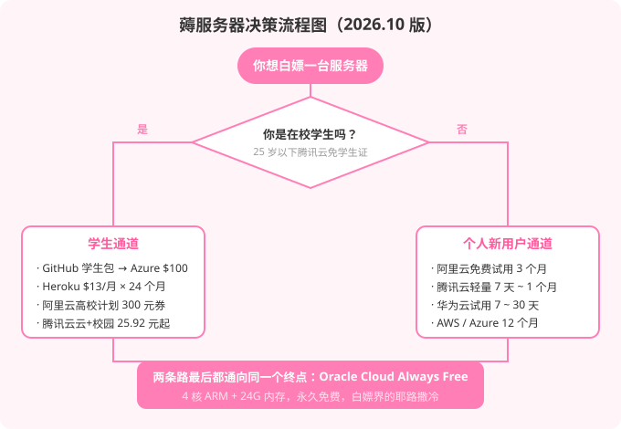
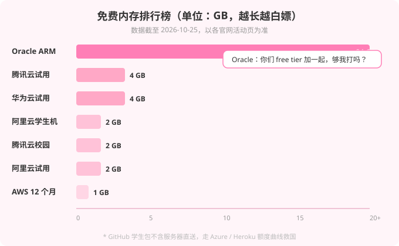
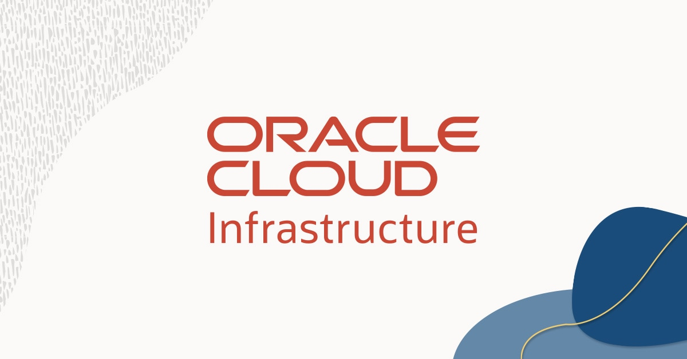

# (｀・ω・´)b 服务器？不存在的。这辈子都不可能租服务器的。

> 这句话我在[上一篇](/posts/arch-web-release/)说过一次，在[上上篇](/posts/arch-web-v2-release/)又说了一次。
>
> 但你们要明白一件事：**嘴硬归嘴硬，服务器该薅还是要薅的。**

前两篇的评论区（如果有的话）总有人问：「你的博客/项目到底跑在哪？」

问得好。答案是：**白嫖的**。这篇文章就把这门手艺完整交代出来——2026 年 10 月最新版，过期攻略粉碎机。

---

## 一、薅前须知：三条铁律

在伸爪子之前，先把这三条刻进 DNA：

| 铁律 | 原因 |
|------|------|
| **实名认证是第一步** | 所有厂商的免费资源都要实名，这是过滤脚本羊毛党的行业共识，绕不过去 |
| **到期日设日历提醒** | 免费试用到期不主动释放 = 自动转按量计费 = 月底账单教你做人 |
| **重要数据随时备份** | 免费实例的数据保留期普遍只有 72 小时～15 天，说没就没，不赔 |

记住一个核心认知：**厂商送的叫"试用"，不叫"慈善"**。试用期是把猎枪，你是猎人，也是猎物。

---

## 二、决策流程图：你该走哪条道？

先看两张图热热身。下面逐条道讲解。

---

## 三、学生通道：学生证是硬通货

### 3.1 GitHub Student Developer Pack（学生认证的万神殿）

**地址：** `education.github.com/pack`

这是全网性价比最高的学生福利，没有之一。认证方式：学校邮箱（.edu.cn）或上传学生证/学信网在读证明，审核几小时到几天。

当前（2026.10）包里跟"服务器"相关的硬货：

| 福利 | 额度 | 说明 |
|------|------|------|
| **Azure for Students** | $100 / 12 个月 | 免信用卡，可续期，65+ 服务永久免费层 |
| **Heroku** | $13/月 × 24 个月 | 够跑一个 Eco dyno + 小 Postgres，能扛完整个毕设 |
| **MongoDB Atlas** | $50 抵扣 + 免费认证 | 认证考试免费，简历上比 $50 值钱 |
| **Namecheap / .TECH / Name.com** | 免费域名 ×3 | 个人主页三件套，.me 域名一年 |
| **JetBrains 全家桶** | 学生免费 | IntelliJ / PyCharm / WebStorm，每年续 |

**⚠️ 重大辟谣：DigitalOcean 的 $200 额度，2026 年 7 月 31 日已经正式结束。**

你现在去搜「GitHub 学生包 服务器」，十篇教程有八篇还在写 DO $200——全是 2024 年的过期货。DO 已经不在当前合作名单里，写这些攻略的人自己都没去领过。**这就是为什么薅羊毛也要看发布日期。**

### 3.2 阿里云高校计划

**地址：** `university.aliyun.com`

学生认证走支付宝扫码授权，系统自动对接学信网学籍数据，通过后发 **300 元无门槛代金券**（有效期 1 年）。

用法：券直接抵 1 核 2G 的 ECS/轻量，**最长能白嫖 12 个月**。毕设、课程实训、个人长期项目，这就是续命神器。

### 3.3 腾讯云云+校园

**地址：** `cloud.tencent.com/act/campus`

腾讯的校园价不是"免费"，但是"接近白嫖"的便宜：

- 2 核 2G 4M 轻量：**25.92 元 / 3 个月**（一天不到 3 毛）
- 2 核 4G 5M：**46.43 元起**
- **25 周岁以下免学生证认证**，这条对大学生基本等于没有门槛

结论：**阿里云学生通道是纯薅，腾讯云校园通道是半薅**。两个都走，不冲突。

---

## 四、个人新用户通道：不薅白不薅

### 4.1 阿里云免费试用（3 个月）

**地址：** `free.aliyun.com`

个人新用户（没买过 ECS 的账号）可以领 ECS 或轻量应用服务器免费试用，**最长 3 个月**，配置 2 核 2G / 1M 带宽 / 40G ESSD 起步，最高有 8 核 16G 的规格可选。

**坑点警告：**
- 同一实名信息全账号只能领一次，注册小号也没用
- **试用 ECS 不支持 ICP 备案**——内地节点不能搭面向公众的网站，仅限开发调试。想建公开站请买付费包年包月机备案
- 到期释放后数据只保留 **72 小时**，超时清空
- 额度耗尽或到期会转按量计费，务必设余额提醒

### 4.2 腾讯云免费试用

**地址：** `cloud.tencent.com` → 免费试用/体验馆

新用户可领轻量/CVM 短期试用（7 天～1 个月，以活动页实时为准）。腾讯的优点是试用到期后有 **15 天缓冲期**，缓冲期内续费或打快照都能保住数据，比阿里云 72 小时仁慈多了。

同价位段的「接近白嫖」还有：**4 核 4G 3M 轻量秒杀 38 元/年**（新人专享，手速活），以及 **2 核 2G 同价续费 99 元/年**（新老同享，续费不涨价——这在云厂商里稀有得像熊猫）。

### 4.3 华为云

**地址：** `huaweicloud.com` → 免费试用

新用户 7～30 天试用，1 核 2G / 2 核 4G 为主，部分产品标注"永久免费"。华为云的特色优势是**备案流程规范清晰**，有备案需求的可以拿它提前跑通流程。

### 4.4 Oracle Cloud Always Free（白嫖界的耶路撒冷）

**地址：** `oracle.com/cloud/free`

前面排行榜里那根 24GB 的柱子就是它。规则很简单：

- **ARM（Ampere A1）：4 核 + 24GB 内存**，可拆成最多 4 台实例
- **AMD x86：2 台 micro**（1/8 核 1G，别指望，能开机）
- 存储合计 200GB
- **永久免费**，不是试用

代价（天下没有白嫖的午餐，只有带刺的）：

| 刺 | 说明 |
|----|------|
| 要国际信用卡 | Visa/Mastercard 验证，预授权后返还；风控对虚拟卡敏感 |
| 热门区域常年 "Out of capacity" | 首尔春川、东京、美西相对好抢，新加坡法兰克福随缘 |
| 闲置会被回收 | CPU 长期低于 10% 可能被判定闲置停机——挂个监控脚本保平安 |
| 账号说删就删 | 风控误伤不是传说，重要数据勤快打快照 |

用法建议：拿到就开自动快照 + 搭个 uptime 监控，低调使用，别当生产环境跑商业业务。

### 4.5 AWS / Azure（海外双雄，一句话带过）

- **AWS**：12 个月 t3.micro（1 核 1G），每月 750 小时，出站流量约 100GB 上限——注意流量刺客
- **Azure for Students**：见 3.1，$100 免卡 12 个月，学生通道里最稳的一张牌

---

## 五、小厂野区：快快云们

你点名了**快快云**（kkidc.com，福建快快网络旗下），那必须说道说道。

先说结论：**快快云没有成规模的学生免费服务器计划**。它的主业是高防——游戏盾、DDoS 防护、WAF 这类，官网内容基本围绕安全产品转。学生向的内容只有一篇选购攻略，意思是「学生可以来买便宜的」。

那还写它干嘛？两个理由：

1. **它有存在的合理性**：如果你要搭游戏私服、麦块服、怕被打的小站，国内小厂的高防机确实便宜，快快云是这条赛道的活跃玩家
2. **小厂薅羊毛的风险教育**：搜索引擎里「免费云主机」排前面的小商家，一半是超售严重的切片机，一半是拿你手机号喂客服。挑小厂三条军规：**查牌照、看合同发票、远离要预充值的「永久免费」**

酷盾、酷番云、简米云这些小厂同理——有真实可领的试用，但薅完请记得：**跑路是小厂的第一大风险，配置表上的数字是第一大幻觉**。

---

## 六、终极薅法：根本不需要服务器

说个暴论：**90% 想薅服务器的人，根本不需要服务器。**

- 静态博客 / 作品集 → **Cloudflare Pages / Vercel / Netlify 免费额度**直接挂，还自带全球 CDN
- 小程序 / 全栈小项目 → **微信云开发 / CloudBase** 有免费额度，不用买服务器
- 本站就是活广告：从 arch-web 到这篇博客，**全栈跑在免费静态托管上，一台服务器都没有**

> 服务器？不存在的。这辈子都不可能租服务器的。（第三遍，理直气壮）

那什么时候真该买？当你受够了 Oracle 的回收、试用的到期、小厂的超售——**Hetzner CX22，2 核 4G，€4.9/月**，便宜过所有白嫖的隐形成本。白嫖是青春，付费是成年礼。

---

## 七、FAQ

**Q: 全部薅一遍能凑出多少台？**
A: 理论上：阿里云试用 1 + 阿里云学生券 1 + 腾讯云试用 1 + 腾讯云校园 1 + 华为云 1 + Oracle 4 台 ARM + AWS 1 + Azure 1 ≈ **10 台+**。实际上你只会用得上 2 台，别问我怎么知道的。

**Q: 薅到的机器适合干嘛？**
A: 学 Linux 命令、搭博客测试环境、跑爬虫、挂机器人、毕设演示。**不适合**：生产业务、重要数据、商业项目、任何你输不起的东西。

**Q: 试用到期忘了续，数据真没了？**
A: 阿里云 72 小时，腾讯云 15 天缓冲，Oracle 回收即没。**快照！快照！还是快照！**

**Q: Oracle 免费实例会被删？**
A: 会。风控误删、闲置回收、容量调整都是公开的秘密。把它当「随时会跑路的好心人」对待：数据多备一份，服务分散部署，心态放平。

**Q: 学生认证毕业后福利还在吗？**
A: 不在。学生身份失效后阿里云券到期、腾讯云校园价失效、GitHub 包收回。趁还在校，赶紧薅——这是你学生证剩的不多的特权之一。

**Q: 为什么你的攻略和别人写的不一样？**
A: 因为我的发布日期是 2026 年 10 月 25 日，而我花了半小时核实每一条。网上 80% 的同类文章连 DO 额度已停都不知道。

---

## 八、结语

白嫖是一门行为艺术。它的核心不是省钱，是**在规则允许的范围内，把每一条福利用到极致**的过程本身。

学生认证、新用户试用、永久免费套餐——这些门槛设计出来就是筛人的，而你要做的，就是那个穿过筛子的人。

> (｀・ω・´)b 服务器是租不起的，但羊毛是可以薅的。

最后提醒：日历提醒设好了吗？快照打了吗？都没有？那你不是薅羊毛，你是被羊薅。

---

*本文所有活动政策截至 2026 年 10 月 25 日。云厂商的福利比翻书还快，薅之前以官网活动页为准。如果发现哪条过期了，来评论区喊一声，我改。*
