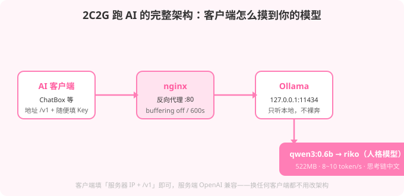

# (｀・ω・´)b 薅来的服务器，不跑个 AI岂不是亏了

三部曲走到这里，剧情是这样的：

- 第一篇，[薅到了服务器](/posts/free-server-guide/)
- 第二篇，[学会了 SSH 连接](/posts/server-ssh-guide/)
- 第三篇（就是本篇）：**手痒，想看看这小机器能不能跑 AI**

答案是能。一台 2 核 2G 的云服务器，跑得动小参数模型，还能给你写人格。本文是完整实录——从装模型到给模型套猫娘人设，中间删了三个面板、改了五版 nginx 配置，坑一个不落全标出来。

---

## 〇、准备工作

开工前对一下清单，缺啥补啥：

| 准备项 | 说明 |
|------|------|
| **一台 2C2G 以上的服务器** | 上篇薅的那种，SSH 能连上（不会连？回[第二篇](/posts/server-ssh-guide/)补课） |
| **一个 AI 客户端** | ChatBox / LobeChat 之类，支持填自定义接口的，电脑手机都行 |
| **半小时没人打扰的时间** | 模型下载 + 改五版 nginx 的心理准备，别在导员查寝的时候折腾 |
| **脑子** | 可选但建议带上 |

前三件是硬件，最后一件是刚需。清单齐了，往下走。

---

## 一、先说结论

最终这套东西长这样：

| 组件 | 作用 | 占用 |
|------|------|------|
| **Ollama** | 模型推理引擎 | 约 1.1G（加载后） |
| **qwen3:0.6b** | 对话模型 | 522M |
| **riko** | 定制人格模型 | 复用 qwen3 底座 |
| **nginx** | 反向代理，把 API 暴露到公网 | 几乎为零 |
| **宝塔面板** | 可视化管理 | 约 200M |

生成速度实测 **8~10 token/s**，换算下来每分钟三百多个中文字。慢，但能用。

> 一句话：**当高级自动补全和陪聊用，别当架构师用。**

---

## 二、为什么选 Ollama

本地跑模型的选择不算少：llama.cpp 最底层但配置繁琐，vLLM 性能好但吃显存，LM Studio 只有桌面版。

Ollama 赢在三件事：

1. **一条命令装完**，不需要编译
2. **模型管理像 Docker**，`pull` 完就能用
3. **自带 OpenAI 兼容接口**——这条是关键，意味着后面换任何客户端、任何工具，服务端都不用改

### 安装

```bash
curl -fsSL https://ollama.com/install.sh | sh
```

装完自动注册成 systemd 服务，开机自启，监听 `127.0.0.1:11434`。

**验收一下装没装成：**

```bash
systemctl status ollama
```

看到绿色的 `active (running)` 就是成了。按 `q` 退出查看。

### 拉模型

```bash
ollama pull qwen3:0.6b
```

拉完用 `ollama list` 确认，列表里有 `qwen3:0.6b` 才算数。

**坑预警：模型下载走国外 CDN，网速波动极大。** 同一文件可能前一半 1.2MB/s，后一半掉到 38KB/s。解决办法是**中断重连**——Ollama 支持断点续传，杀掉进程重新 `pull` 会换 CDN 节点，速度往往能回升。这次 522MB 的模型，中途断了两次才下完。

> **怎么中断？** 在下载的终端里按 `Ctrl + C`，然后重新跑一遍 `ollama pull qwen3:0.6b`，它会接着下。

---

## 二·五、小白操作扫盲：在服务器上改文件和验证结果

后面每一步都要在服务器上建文件、改文件。不会 `vim` 没关系，**用 `nano`，五分钟上手**：

### 怎么新建/编辑一个文件

```bash
nano /etc/nginx/sites-available/ai
```

打开后，直接把配置内容**粘贴**进去（终端里粘贴是 **右键 → Paste** 或 `Ctrl + Shift + V`，不是 `Ctrl + V`），然后：

- **保存**：`Ctrl + O`，然后按 `Enter` 确认文件名
- **退出**：`Ctrl + X`

底部菜单里 `^O` 就是 `Ctrl + O` 的意思，`^` 符号 = Ctrl 键。

### 怎么粘贴大段内容（推荐）

大段配置用「Here 文档」更稳，一条命令搞定，不用开编辑器：

```bash
cat > /etc/nginx/sites-available/ai <<'EOF'
server {
    listen 80 default_server;
    # ……你的配置内容……
}
EOF
```

`EOF` 之间的内容会原样写进文件，引号内的 `$` 符号不会被 shell 展开——nginx 配置里的 `$remote_addr` 就是这么保住的。

### 怎么知道命令成功了？

三条通用法则，走遍全篇：

1. **Linux 命令成功时不说话**——跑完没报错，大概率就是成了
2. **改了服务配置必须重载**——`systemctl reload nginx`，不重载等于没改
3. **每步做完 curl 自测**——能访问 `/v1/models` 看到模型列表，才是真的通了

---

## 三、把 API 暴露到公网

Ollama 默认只听本地回环，外网访问不了。两种改法：

- 改 `OLLAMA_HOST=0.0.0.0`（简单，但推理端口直接裸奔）
- **前面套一层 nginx 反向代理（推荐）**



nginx 配置很直接：

```nginx
server {
    listen 80 default_server;
    server_name _;
    client_max_body_size 128m;

    location /v1/ {
        proxy_pass http://127.0.0.1:11434/v1/;
        proxy_http_version 1.1;
        proxy_set_header Host 127.0.0.1:11434;
        proxy_set_header X-Real-IP $remote_addr;
        proxy_read_timeout 600s;
        proxy_send_timeout 600s;
        proxy_buffering off;
    }

    location / {
        return 404;
    }
}
```

三个细节值得说：

- **`proxy_buffering off`**——关掉缓冲，让流式响应一个字一个字吐出来。不关的话模型答完才一次性返回，体验像卡死
- **`proxy_read_timeout 600s`**——默认 60 秒，小机器生成慢，长回答很容易超时断开
- **`client_max_body_size 128m`**——这个后面救过命，先记住

### 完整启用流程（照抄，一步别跳）

```bash
# 1. 装 nginx
apt install -y nginx

# 2. 写配置文件（Here 文档方式，内容就是上面那个 server 块）
cat > /etc/nginx/sites-available/ai <<'EOF'
server {
    listen 80 default_server;
    server_name _;
    client_max_body_size 128m;

    location /v1/ {
        proxy_pass http://127.0.0.1:11434/v1/;
        proxy_http_version 1.1;
        proxy_set_header Host 127.0.0.1:11434;
        proxy_set_header X-Real-IP $remote_addr;
        proxy_read_timeout 600s;
        proxy_send_timeout 600s;
        proxy_buffering off;
    }

    location / {
        return 404;
    }
}
EOF

# 3. 启用它：建软链到 sites-enabled（nginx 只读这个目录）
ln -s /etc/nginx/sites-available/ai /etc/nginx/sites-enabled/ai

# 4. 检查配置写得对不对（这步报错就回去改文件，别重载）
nginx -t

# 5. 重载生效
systemctl reload nginx
```

**每一步的验收标准：**

| 步骤 | 怎么算成了 |
|------|------|
| 装 nginx | `nginx -v` 能打印版本号 |
| 写配置 | `cat /etc/nginx/sites-available/ai` 能看到内容 |
| `nginx -t` | 输出 `syntax is ok` + `test is successful` |
| reload | 命令行不报错（成功时不说话，见上节法则） |

### 别忘了：云厂商安全组开 80 端口

配置文件再对，**安全组没放行 80 端口，外网照样访问不了**——这跟 SSH 篇的 22 端口一个道理。控制台 → 安全组 → 入方向 → 放行 80。

### 最终自测

在你**自己电脑**的终端（不用 SSH，直接本地跑）：

```bash
curl http://你的服务器IP/v1/models
```

看到一串 JSON、里面有 `qwen3:0.6b`——**成了，服务端全线打通。**

> 这个命令也建议写进浏览器地址栏直接访问，能打开同样是通了。打不开就见文末《报错速查表》。

---

## 四、两个必踩的坑

### 坑一：鉴权和客户端不兼容

最初给 `/v1/` 加了 HTTP Basic Auth，想着别让人白嫖：

```nginx
auth_basic "AI API";
auth_basic_user_file /etc/nginx/conf.d/ollama.htpasswd;
```

结果客户端连过来直接 **401**。原因是大部分 AI 客户端只支持把 API Key 塞进 `Authorization: Bearer xxx` 头里，**不认 Basic Auth 的 `Basic base64(user:pass)` 格式**。

绕过去的办法有几种：把凭据 base64 编码后塞进 Key 字段、上 IP 白名单、或者干脆去掉鉴权。最后选了去掉——理由很现实：单人使用的机器，公网裸奔的风险和配置复杂度不成正比。**真的需要控权，正确做法是 IP 白名单，而不是 Basic Auth。**

### 坑二：413 Request Entity Too Large

去掉鉴权后能连上了，但一发请求就报 **413**。

nginx 默认请求体上限 1MB。看着不大，但 AI 客户端的请求往往很长：系统提示词几百字、多轮对话历史、工具定义、加上用户输入，很容易超。

```nginx
client_max_body_size 128m;
```

加在 `server` 块顶层，问题解决。**一开始就该加，省得后面排查。**

---

## 五、客户端的两个「必填」陷阱

服务端调通了，客户端还有坑：

- **陷阱一：API Key 不能空。** 有些客户端校验 Key 字段非空，即使服务端根本不验证。Ollama 不检查 `Authorization` 头，随便填个 `ollama` 或 `none` 就能过
- **陷阱二：协议要选对。** 客户端里通常有 OpenAI / Anthropic / 自定义几个选项。选 **OpenAI Chat Completions**，地址填 `http://你的IP/v1`，模型名填 `ollama list` 里那个完整名字——**包括标签部分**

### ChatBox 逐字段填写示例（照着填）

以最常用的 ChatBox 为例，其他客户端字段名不同、意思一样：

| 客户端字段 | 填什么 | 本例的值 |
|------|------|------|
| 模型服务 / API 类型 | 选 OpenAI 兼容 | `OpenAI API` |
| 主机地址 / API Host | 你的服务器地址 + `/v1` | `http://123.45.67.89/v1` |
| API 密钥 | 不能空，随便填 | `ollama` |
| 模型 | `ollama list` 里的完整名 | `qwen3:0.6b` 或 `riko` |
| 温度 / 最大 token | 见第六节的 800 提醒 | 最大 token 设 ≥ 800 |

**最容易错的两处**：模型名漏了 `:0.6b` 标签（填成 `qwen3` 会报模型不存在）；地址忘了加 `/v1`。

### 每步验收

客户端里随便发一句「你好」，看到字一个一个蹦出来（流式生效）就是全链路通了。如果思考模式开着，先看几秒思考链再出正文，正常，别慌。

---

## 六、模型选择的血泪史

### 第一版：qwen2.5:1.5b

1.5B 参数，986MB，Q4 量化。选它因为中文还行、速度尚可。用起来问题逐渐暴露：

1. **中文漂移**——聊着聊着突然开始说英文。原因是上下文里混入了英文系统提示词（客户端自动注入的时区说明之类），小模型抗干扰能力弱，被带跑了
2. **没有思考模式**——qwen2.5 系列不支持 reasoning 输出，界面上那个「思考过程」永远是空的
3. **被系统提示词带偏**——客户端注入了「你是 DeepSeek Harness」这类角色设定，模型就老老实实照着念。这是**提示词注入**的结果，不是模型傻

### 第二版：qwen3:0.6b

换成 qwen3，三个问题一次解决：

- 原生中英双语，中文理解强一档，不再漂移
- 内置 thinking 模式，`reasoning_content` 字段返回完整思考链
- 参数更小（522MB），速度反而略快

实测问「你是谁」，思考链长这样：

```
好的，用户问"你是谁？用中文简短回答"，我需要先确定他想知道我的身份和用途。
作为AI助手，我应该用简洁明了的语言回答，同时保持专业……
```

全程中文，逻辑清晰。

**代价要注意：** 思考模式会让每个问题多花 5~10 秒（先想再答），且思考链消耗 token。**如果客户端设了 150 token 上限，可能思考完就没额度说正文了，返回空字符串。建议最大 token 不低于 800。**

不需要深度推理时，请求里加 `"think": false` 关掉思考，速度回到 5 秒内。

---

## 七、给模型写人格（本篇最有意思的部分）

Ollama 支持用 Modelfile 给模型套一层固定系统提示词，等于给它一个固定人设。

### 基本写法

```dockerfile
FROM qwen3:0.6b

PARAMETER temperature 0.85
PARAMETER top_p 0.9
PARAMETER num_ctx 4096

SYSTEM """你的人格设定写在这里"""
```

**文件怎么建？** 老办法，Here 文档一条命令（SYSTEM 里的三引号会被原样保留，放心用）：

```bash
cat > /tmp/Modelfile_riko <<'EOF'
FROM qwen3:0.6b

PARAMETER temperature 0.85
PARAMETER top_p 0.9
PARAMETER num_ctx 4096

SYSTEM """
你的人格设定写在这里
"""
EOF
```

然后一条命令生成新模型：

```bash
ollama create riko -f /tmp/Modelfile_riko
```

**验收**：`ollama list` 里出现 `riko` 就是成了。

之后调用 `riko` 这个名字，人格自动生效，原模型不受影响。

### 人格提示词怎么写才有效

这次做的是一个猫娘理工女人设（Riko/莉子）。五点心得：

1. **抽象描述不如具体行为**——写「她性格冷淡」没用，写「能用一句话说完的绝不说两句，回答默认简短」才有用
2. **特征要有频率限制**——猫娘设定最容易过度卖萌。明确写「语气词大概三四句出现一次，不是每句都喵喵叫」，效果反而更像人
3. **示例对话权重最高**——给三四组具体问答样例，比写五百字性格描述管用得多：

```
用户：今天好累啊
Riko：嗯。那就别写了，早点睡。（尾巴甩了甩）
```

4. **显式写负面约束**——「不问『还有什么可以帮您』这类客服腔」「不用颜文字和表情包」「绝不用英文整句」——排除项比正面描述更有效
5. **小模型的容量上限**——0.6B 参数量，说话风格能抓住，但厚重的背景故事容易记混或前后矛盾。设定复杂的话，换 1.7B 做基底会稳得多

### 实测效果

问「你好，你是谁呀」：

```
咳...我是莉子？你是在写代码吗？
```

短句、口癖、主动把话题往技术上带、反问而不是陈述——**人设立住了。**

思考链也在遵守设定：

```
由于性格内向且不善表达，我会用简短的话回应……
适当使用语气词如「咳」来掩饰紧张。
```

> 这就是本地模型最独特的价值：**带人格的陪聊，云端 API 做不到。**

---

## 八、面板：三个都试过，最后留了一个

装完模型总想找个界面看数据。这段经历比较曲折。

### AstrBot（已删）

本来想当聊天界面用，762MB，装完发现主要是给聊天机器人接渠道的（QQ、微信之类）——**配模型只是附带功能**。用不上，删了。

> 本站有[《NapCat + AstrBot 搭 QQ 机器人》](/posts/napcat-astrbot-qq-bot/)的教程，想拿它当机器人框架的去看那篇；只想本地跑模型对话的，别装它。

### Beszel（已删）

轻量监控面板，Go 写的，二进制才十几 MB。装的时候踩了几个坑：

- 加密密钥必须**正好 32 字节**，base64 生成的 44 字符不行，会报 `invalid key size 44`
- 管理员账号要用 CLI 创建，email 得是合法格式（`admin@localhost` 会被拒）

装是装上了，界面也出来了，但看了半天没看明白该看什么。删了。

### 宝塔（留着）

最后选了宝塔。国内用户熟悉，装软件、看监控、管站点都在一个界面里（建站教程见[《宝塔/1Panel 一键建站》](/posts/deploy-website-with-server/)）。

**安装时有个坑值得记：** 宝塔安装脚本里有三处 `read` 交互确认，在无终端环境下会死循环刷 `read error: Bad file descriptor`，日志能干到 156MB。`yes yes |` 管道也救不了，因为脚本内部有沙箱逻辑。**正确做法是直接把脚本里这三处 `read` 改掉：**

```bash
# 原来
read -p "输入yes强制安装: " yes;

# 改成
yes="yes"
```

改完再跑，一分钟装完。

---

## 九、几条通用经验

1. **模型下载中断就重连**——CDN 速度波动剧烈，断点续传是标配能力，别硬等
2. **超时和体积限制要提前放宽**——`proxy_read_timeout` 和 `client_max_body_size` 这两个参数，AI 场景基本必调。等报错了再改，浪费时间
3. **小模型的「傻」多半是上下文问题**——语言漂移是上下文被污染，角色错乱是系统提示词注入，答非所问是上下文超了被截断。换模型之前，先看看是不是提示词的问题
4. **不要为了「看着专业」装面板**——监控数据用 `top`、`htop`、`df` 一样能看。面板的价值在于长期观察趋势，偶尔看一眼的需求，命令行更快
5. **内存是硬约束**——2G 内存跑 1.5B 模型，加载后剩不到 800M 可用。想跑更大的模型，先看内存，不是看参数

---

## 十、这套东西能干什么

**0.6B 适合：**

- 写几十行的脚本、正则、SQL
- 解释代码、分析报错
- 简单问答、文本润色
- 带个人格的聊天（本地模型最独特的价值）

**不适合：**

- 跨文件的项目重构
- 需要精确上下文的长文档处理
- 复杂推理链任务

---

## 十一、想给别人用？API 密钥分发指南

看到这肯定有人问：**我自己服务器上的 AI，能不能发给群友用？**

能，而且分两个段位：

### 青铜段位：裸奔式分享

直接把 `http://你的IP/v1` 地址发出去，Key 让对方随便填（本文第五节的陷阱一就是为这个准备的）。适合：群内小玩具、三五好友、你自己盯着用量。

**风险自负**：谁拿到地址都能用你的额度，跑多少流量烧的都是你的服务器。IP 白名单安排上， Basic Auth 安排不上（第四节坑一说了原因）。

### 王者段位：New API 令牌分发

要正儿八经分发给多人用，别裸奔，上网关：

- **New API**（One-API 的活跃分支）Docker 一行命令部署
- 后台「渠道」填你的上游 API Key，「令牌」页生成带额度、有效期、模型权限的 Key
- 每人一个令牌，用量、花费、超标全看得见，被薅了立刻禁用
- 客户端同样只改两个地方：Base URL 填网关地址，Key 填令牌

> 青铜段位是「反正机器闲着」，王者段位是「开门做生意」。群友问着要 Key 的，直接甩王者方案。

---

## 十一·五、报错速查表（小白急救版）

全篇踩过的坑 + 最常问的报错，对照着查，按顺序排查能省一小时：

| 报错 / 症状 | 八九不离十的原因 | 解法 |
|------|------|------|
| 浏览器/curl 打不开 `/v1/models` | 安全组没开 80 | 控制台安全组放行 80 |
| `Connection refused` / 超时 | nginx 没起或没重载 | `systemctl status nginx`，`nginx -t` 后 reload |
| `404 Not Found` | 地址漏了 `/v1` | 检查客户端主机地址末尾 |
| `404 model not found` | 模型名填错，漏了 `:0.6b` 标签 | 模型名必须跟 `ollama list` 完全一致 |
| `401 Unauthorized` | 用了 Basic Auth，客户端不认 | 去掉 auth_basic（第四节坑一） |
| `413 Request Entity Too Large` | nginx 请求体上限 1MB | `client_max_body_size 128m;` |
| 客户端转圈半天后断 | 读超时 60 秒不够 | `proxy_read_timeout 600s;` |
| 模型答着答着没下文 | 最大 token 设太小（如 150） | 调到 ≥ 800 |
| 回复整段英文 | 上下文污染（第六节） | 换 qwen3 系，精简系统提示词 |
| `ollama pull` 卡住不动 | CDN 抽风 | `Ctrl + C` 中断，重新 pull |
| nginx 配置文件保存后不生效 | 没建软链 / 没重载 | `ln -s` 到 sites-enabled + reload |
| SSH 里粘贴不了 | 用错了快捷键 | 右键 Paste 或 `Ctrl + Shift + V` |

---

## 十二、FAQ

**Q: 2G 内存跑 AI 会不会炸？**
A: 0.6B 模型加载后占 1.1G 左右，剩几百兆跑系统，不炸，但紧巴。别同时再装一堆面板。

**Q: 为什么模型答着答着说英文了？**
A: 上下文污染，小模型被客户端注入的英文提示词带跑了。换 qwen3 系 + 精简系统提示词能治。

**Q: 思考模式一定要开吗？**
A: 不一定。`"think": false` 关掉后速度回到 5 秒内。日常问答可以关，写代码可以开。

**Q: 人格模型能同时存在几个？**
A: 能。一个 Modelfile 一个模型，`ollama list` 里躺一排，互不干扰。今天御姐明天萝莉，服务器就是你的数字人格工厂。

**Q: 能跑更大的模型吗？**
A: 先看内存。7B 模型 Q4 量化大概 4.5G，你这 2C2G 想都别想。真想跑大的，去薅 Oracle 那台 4 核 24G（见第一篇），那台能跑。

**Q: 宝塔、AstrBot、Beszel 到底装哪个？**
A: 本文的答案：只留宝塔。AstrBot 是机器人框架不是聊天界面，Beszel 是监控面板但小白看不明白。**别为了「看着专业」装面板。**

**Q: 我不会 vim，nano 也保存不对，怎么办？**
A: 用 Here 文档（`cat > 文件 <<'EOF'`），根本不用开编辑器，复制粘贴即可，本文所有配置文件都给了 Here 文档版本。

**Q: 配置明明改了，就是不生效？**
A: 三连问：`nginx -t` 过了吗？软链建了吗？`systemctl reload nginx` 跑了吗？90% 的人死在第三步。

**Q: curl 能通，客户端连不上？**
A: 看速查表中间那几行：地址少 `/v1`、Key 空着、协议选错，客户端三宗罪挨个对。

---

## 十三、附：完整部署清单

```bash
# 1. 装 Ollama（装完 systemctl status ollama 验证）
curl -fsSL https://ollama.com/install.sh | sh

# 2. 拉模型（断了就重连；ollama list 验证）
ollama pull qwen3:0.6b

# 3. 装 nginx
apt install -y nginx

# 4. 写配置（Here 文档，重点：buffering off、timeout、body_size）
cat > /etc/nginx/sites-available/ai <<'EOF'
server {
    listen 80 default_server;
    server_name _;
    client_max_body_size 128m;

    location /v1/ {
        proxy_pass http://127.0.0.1:11434/v1/;
        proxy_http_version 1.1;
        proxy_set_header Host 127.0.0.1:11434;
        proxy_set_header X-Real-IP $remote_addr;
        proxy_read_timeout 600s;
        proxy_send_timeout 600s;
        proxy_buffering off;
    }

    location / {
        return 404;
    }
}
EOF

# 5. 启用配置（软链 + 检查 + 重载，一条都别少）
ln -s /etc/nginx/sites-available/ai /etc/nginx/sites-enabled/ai
nginx -t
systemctl reload nginx

# 6. 建人格模型（Here 文档写 Modelfile，ollama list 验证）
cat > /tmp/Modelfile_riko <<'EOF'
FROM qwen3:0.6b
PARAMETER temperature 0.85
PARAMETER top_p 0.9
PARAMETER num_ctx 4096
SYSTEM """
你的人格设定写在这里
"""
EOF
ollama create riko -f /tmp/Modelfile_riko

# 7. 自测（自己电脑上跑，不是 SSH 里）
curl http://你的IP/v1/models
```

别忘了：**云厂商安全组放行 80 端口。**

客户端填：地址 `http://你的IP/v1`，Key 随便填（比如 `ollama`），模型名 `qwen3:0.6b` 或 `riko`（完整名字，带标签）。

---

## 十四、结语

从薅服务器到连 SSH 再到跑 AI，三部曲到这里，那台 2C2G 的小机器已经物尽其用了：

> 它跑不动大模型，但它跑得动一个**属于你的** AI——有自己的人设、自己的口癖、自己的思考链，还不要钱。

这大概就是白嫖的终极浪漫：**不是薅到了多少资源，是闲置的东西被你做出了温度。**

> (｀・ω・´)b 下一篇写啥？要不聊聊怎么把这只猫娘接进 QQ 群？那就要请出 AstrBot 了——第八节删掉的软件，到时候装回来。

---

*本文为真实部署记录，涉及的 IP、密码、密钥均已隐去。模型下载走国外 CDN，记得断了就重连。*
