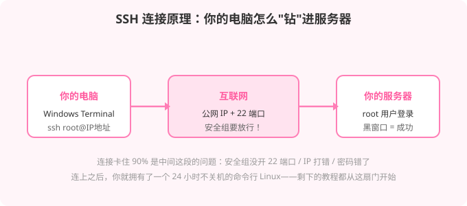

# (｀・ω・´)b 服务器领到了，然后呢？

事情是这样的。

上一篇[《薅服务器指南》](/posts/free-server-guide/)发出去之后，群里当晚就有小白上手实践了。然后我收到了这样的反馈：

> 「嗯嗯，拿到后不知道怎么用呢」
> 「然后就连接后那个就卡了行了」

翻译一下：**服务器薅到了，站在控制台前，茫然了。**

这太正常了。薅服务器攻略解决的是「从 0 到 1」的 0，这篇解决的是那个 1——**领到服务器之后，从 SSH 连接开始的求生指南。**

老手可以叉掉了。这篇是写给小白的，非常小，比 1 核 1G 的那台还小。

---

## 一、先认识你的控制台

不管阿里云、腾讯云还是 Oracle，买到/领到服务器后，先找到厂商控制台里的**实例列表**，点进你那台宝贝服务器，记下三个东西：

| 要找的东西 | 长什么样 | 干嘛用 |
|------|------|------|
| **公网 IP** | `123.45.67.89` 这样的一串数字 | 服务器的"门牌号"，连接就靠它 |
| **root 密码 / SSH 密钥** | 买的时候设置的，忘了可以重置 | 开门的钥匙 |
| **安全组 / 防火墙** | 一个规则列表 | 决定哪些端口对外开放 |

**安全组**是小白第一大杀手，记住它的作用：它就像小区的门禁，IP 是地址，但门禁没给你开 22 端口（SSH 的门），你连个 der。

> 记不住的拿笔记一下：**IP 是地址，22 是门，密码是钥匙，安全组是门禁。** 四件套齐了才能进屋。

---

## 二、装系统：控制台点几下的事

很多人卡在「不知道怎么装系统」——**不用你装，厂商早就装好了**，领的时候选的就是（Ubuntu / Debian / CentOS / Windows Server 之类）。

只是想换/重装的话，控制台里找：

```
实例详情 → 更多 → 云盘与镜像 → 更换操作系统 / 重装系统
```



**小白选系统建议：Ubuntu 22.04 LTS**，没有之一。教程最多、坑最少、复制粘贴就能跑。重装会清空系统盘数据，别把你攒的番剧装在系统盘里。

---

## 三、连接服务器：SSH 入门

SSH 就是远程连进服务器命令行的方式。不需要装任何软件，**Windows 10/11 自带**。

### Windows 用户（95% 的人）

1. 右键开始菜单 → 打开**终端** / Windows Terminal / PowerShell（都行）
2. 输入命令：

```bash
ssh root@你的服务器IP
```

比如 IP 是 `123.45.67.89`，就输入 `ssh root@123.45.67.89`

3. 第一次连接会问 `Are you sure you want to continue connecting?` —— 输入 `yes` 回车（这是服务器的指纹，认一次以后就不再问）
4. 然后提示输密码 —— **输密码时屏幕上什么都不显示，别慌，不是卡了**，这是在防偷窥，照常输完回车

看到 `root@xxx:~#` 这样的提示符？**恭喜，你进屋了。**

### 手机用户

下个 **Termius** 或 **JuiceSSH**，新建连接填 IP、用户名 `root`、密码，保存点进去就行。地铁上也能维护服务器，很赛博。

---

## 四、「连接后卡了」急救室

截图里那位说的「连接后那个就卡了」，对症的全部情况列在这：

| 症状 | 原因 | 解法 |
|------|------|------|
| 命令敲完一直转圈/无响应 | 安全组没放行 22 端口 | 控制台 → 安全组 → 放行 22 端口（来源 0.0.0.0/0） |
| `Connection timed out` | IP 打错 / 服务器没启动 / 网络问题 | 核对 IP；控制台看实例是不是"运行中" |
| `Permission denied` | 密码错 | 控制台重置 root 密码（重启后生效） |
| 密码输完没反应 | **正常现象**，密码就是不显示的 | 盲打完回车 |
| 连上后一输命令就断 | SSH 超时断开 | 重连即可；长时间操作先装 `tmux` 挂后台 |

> 90% 的「卡了」是**安全组没开 22 端口**。门禁不给你开门，你在门口转到天亮也没用。

---

## 五、连上之后，先干这三件事

```bash
# 1. 改个复杂点的密码（顺手的事，安全感爆棚）
passwd

# 2. 更新系统（Ubuntu/Debian）
apt update && apt upgrade -y

# 3. 装个 tmux（断线不怕，会话挂后台）
apt install tmux -y
```

完事。现在你拥有了一台 24 小时开机、归你管的 Linux 机器。接下来去哪？

---

## 六、两条进阶路，自己挑

### 路线 A：面板流（鼠标点点点，适合完全不想记命令的人）

装宝塔面板或 1Panel，可视化建站、装环境、传文件。这篇写过，不重复：

👉 [《买了服务器不会用？宝塔/1Panel 一键建站教程》](/posts/deploy-website-with-server/)

### 路线 B：命令流（学会走捷径，也学会走路）

装个 Docker，然后整个世界都开了一键部署的门：

👉 [《手把手教你搭一个 QQ 机器人（NapCat + AstrBot）》](/posts/napcat-astrbot-qq-bot/)

这篇从零装 Docker 开始，全程复制粘贴——你的服务器当晚就能拥有一个 24 小时在线的赛博打工仔。

**个人博客同理**：静态博客根本不用服务器（前两篇说过了），但如果你想玩动态的（WordPress、Typecho），路线 A 的面板半小时搞定。

---

## 七、FAQ

**Q: SSH 是什么的缩写？**
A: Secure Shell。但小白不用记，会敲 `ssh root@IP` 就够了。

**Q: root 用户是什么？**
A: 服务器的管理员，权力最大，责任也最大。别在 root 下乱删东西，删了真没。

**Q: 密码输了但显示不对/输不进去？**
A: SSH 输密码就是不显示的，这是特性不是 bug。嫌烦可以配密钥，但那是进阶内容，小白先忍着。

**Q: 服务器重启/重装系统后数据还在吗？**
A: 重启在，重装（换系统）没。系统盘里的东西重装全清，重要数据放数据盘或本地。

**Q: 连接总是过一会儿自动断？**
A: SSH 默认超时断开。重连就行；跑长任务先 `tmux new -s work`，断了再 `tmux attach` 接回来，打工仔永不下班。

**Q: 照着做了还是连不上？**
A: 把报错信息原样发群里，别转述。转述会丢失关键信息，比如 `Permission denied` 和 `Connection refused` 是两个世界的问题。

---

## 八、结语

回顾一下小白的完整链路：

> 薅到服务器 → 记下 IP/密码/安全组 → 控制台重装成 Ubuntu → `ssh root@IP` → 看到 `root@xxx:~#` → 改密码、更新系统 → 选面板流或命令流进阶

到这里，「薅服务器」三部曲就齐了：**薅（上篇）→ 连（本篇）→ 用（站内两篇老教程）**。

服务器这东西，第一次连上的时候，你会觉得自己像个黑客；第三次连上的时候，你会觉得像个网管；第三十次连上的时候——你会明白为什么有人说「命令行是程序员最好的朋友」。

> (｀・ω・´)b 从「不知道怎么用」到「就这」，中间只差一篇教程和一次尝试。

---

*如果哪位小白照着做了还是卡住，欢迎来群里@我。报错截图直接发，别打字，打字会累，我也会。*
